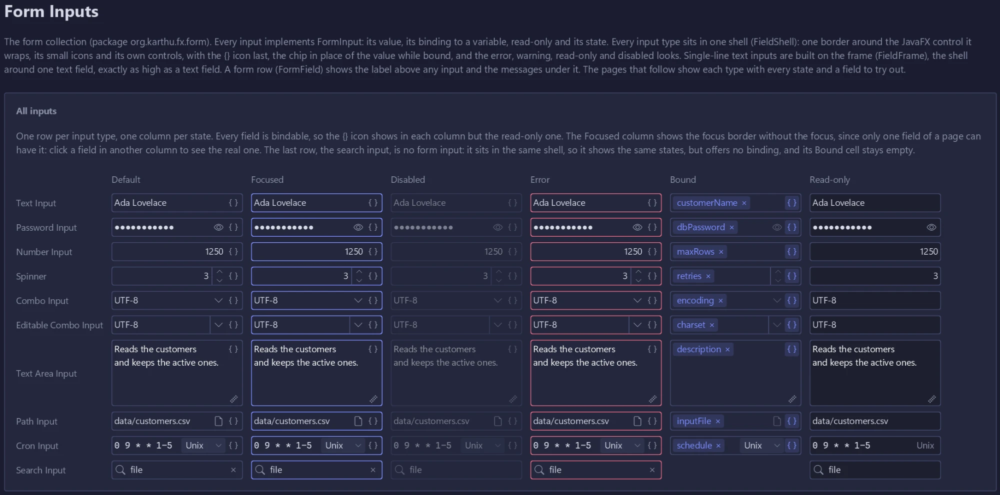
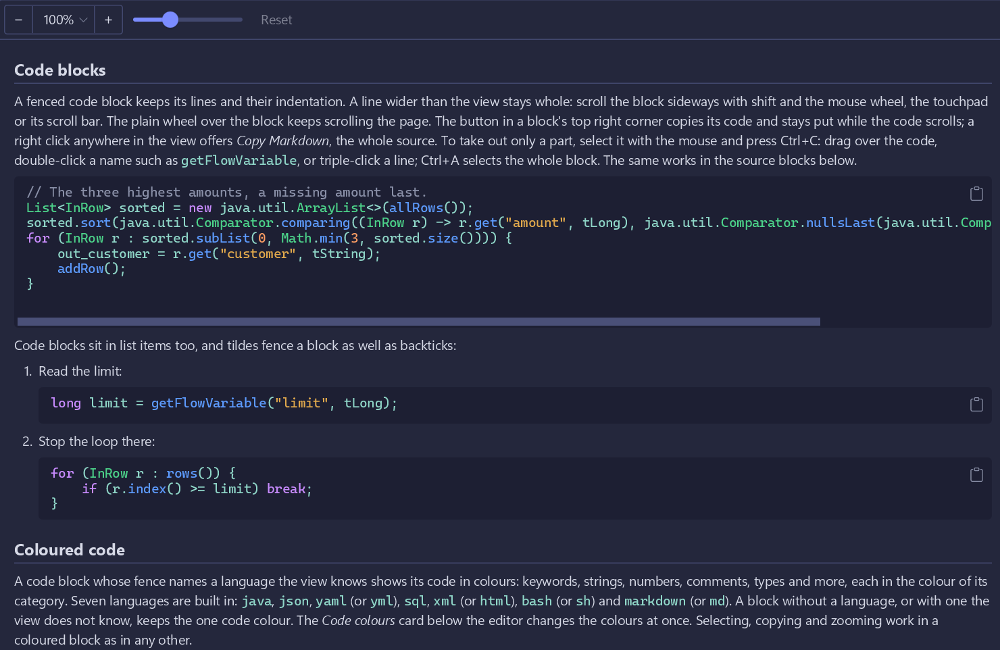
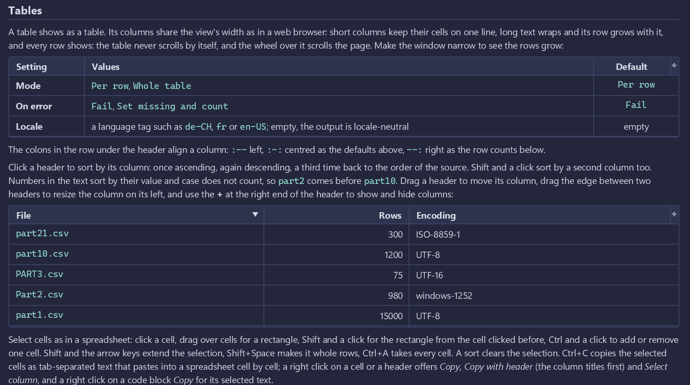

# Karthu FX

JavaFX components with a theme of their own, light or dark, and a showcase application that shows
them all.

> **Under development. Please do not build on it yet.**
>
> **Created with AI.** The code, the tests and the documentation were written with an AI assistant
> (Claude), directed by a human. Today Karthu FX is a demonstration of components, not a finished
> library.

## What it is

- **A demonstration.** It shows what JavaFX components built with an AI assistant look like:
  themed dialogs, a settings dialog, form inputs, a Markdown view, commands with keyboard
  shortcuts the user can change, a side bar with a searchable navigation tree, and a few custom
  controls, all in one theme with two colour schemes, Nebula Light and Nebula Dark.
- **A showcase application.** Every component and every themed standard control has a page to
  click through, in either scheme: a switch in its toolbar chooses Light, Dark or System.
- **Free to read and to copy from.** The licence is MIT-0: take what is useful, no attribution
  needed.

## What it is not

- **Not a finished library.** It is still changing. An API may change or disappear from one
  version to the next, without notice and without a migration path.
- **Not for production.** It has automated tests, but it has not been proven in other people's
  applications.
- **Not supported.** No issues, no pull requests, no answers, and no promise that the work goes on.
- **Not a general toolkit.** One theme in a light and a dark scheme, and it needs JDK 25 and
  JavaFX 25.

## Highlights

### Form inputs that look and behave alike

Text, password, number, combo, text area, path and cron inputs sit in one shell: the same height
and frame, and the same focused, disabled, error, bound and read-only looks.

- **Variables.** Every input takes a variable in place of a value: the `{}` icon, or Ctrl+Space,
  lists the variables the application offers, and the bound one shows as a chip in the field.
- **States and messages.** A form row shows the label above the input and errors, warnings and
  hints under it. The library only displays them; the application validates.
- **Types with their own help.** A password field with an eye to reveal it, a number field with a
  range and spinner arrows, a path field with a file dialog and drag and drop, and a cron field
  that says in plain English what the expression means.



### Light, dark or as the system has it

Every component comes in two colour schemes, Nebula Light and Nebula Dark, which share every shape
and size. An application chooses Light, Dark or System with one call, `ThemeManager.setAppearance`,
and every window follows at once; System follows the light or dark setting of the operating
system, also when it changes while the application runs. Without a choice the theme stays dark.
An application's own colours get a value per scheme in its own stylesheet.

### A Markdown view without a browser

`MarkdownView` shows Markdown as plain JavaFX nodes. It needs no `WebView` and no `javafx.web`
module, so no browser engine ships with the application. Code blocks are coloured for seven
languages, the reader selects, copies and zooms as in a browser, and a search field connected to
the view marks every match and goes from one to the next.



Its tables are real tables: click a header to sort, drag a header to move or resize its column,
show and hide columns, and select cells to copy them into a spreadsheet.



### A side bar as in an IDE

`SideBar` puts an application's panels at the left or right edge of its window, like the tool
window bar of an IDE: a narrow stripe of icons, one panel open at a time beside the content,
collapsed to the stripe with a click, its width dragged at its edge, and its tabs on Alt+1 to
Alt+9 among the application's commands.
Its ready-made content, `NavigationTree`, shows the application's own tree under a search field
that narrows it to the hits and, once cleared, gives the tree back folded as the user left it.

## Have a look

With JDK 25 and Maven 3.9 or newer:

```bash
mvn clean install                      # build the library and the showcase
mvn javafx:run -pl karthu-fx-showcase  # start the showcase
```

## More

- [What the library holds](docs/components.md), component by component
- [A guide for coding agents](docs/agent-guide.md): setup, rules and a tested sample for each
  component, for building with karthu-fx in another project
- [Getting, building and running it](docs/getting-started.md): modules, Maven coordinates, the
  Windows executable
- [The theme](STYLEGUIDE.md): colours, sizes, style classes
- [What changed](CHANGELOG.md), version by version
- [How a version is released](docs/releasing.md)

## Licence

[MIT-0](LICENSE). Provided as is, without warranty: use it at your own risk.
