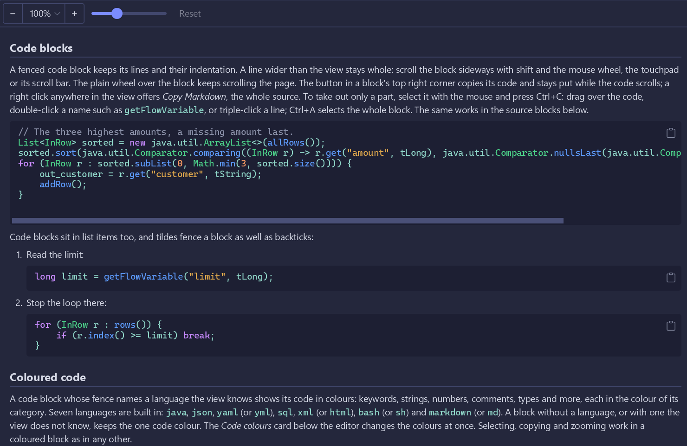
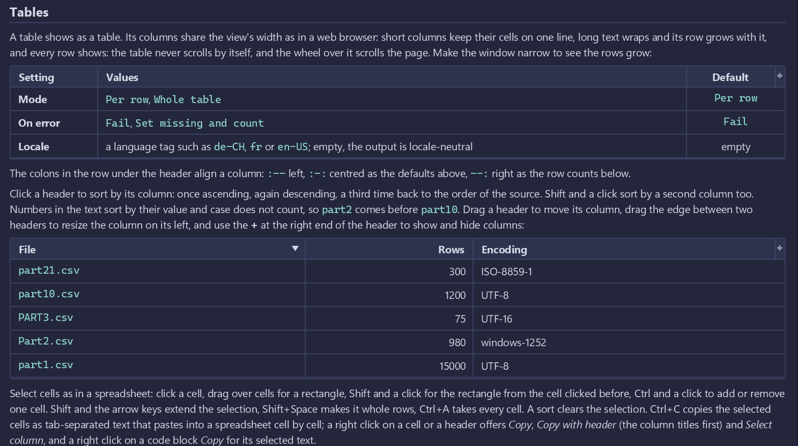
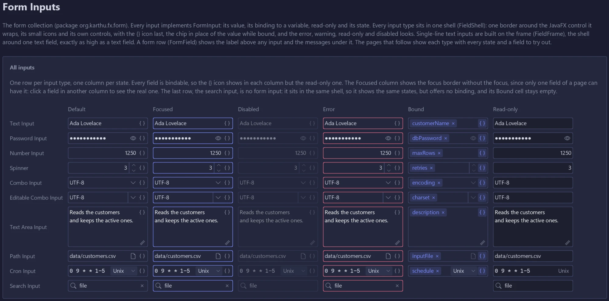

# What karthu-fx provides

Everything in `karthu-fx-core` (JPMS module `org.karthu.fx`), package by package. The API itself is
documented in the JavaDoc; the style classes, pseudo-classes and colour tokens are listed in
[`STYLEGUIDE.md`](../STYLEGUIDE.md). How to get, build and run it: [`getting-started.md`](getting-started.md).

- [Theming](#theming)
- [Configuration](#configuration)
- [Dialogs](#dialogs)
- [Settings](#settings)
- [Controls](#controls)
- [Markdown view](#markdown-view)
- [Form fields](#form-fields)
- [Commands and keyboard shortcuts](#commands-and-keyboard-shortcuts)
- [Side bar and navigation tree](#side-bar-and-navigation-tree)
- [Icons](#icons)

## Theming

The library ships one theme in two colour schemes, **Nebula Light** and **Nebula Dark** (see
[`STYLEGUIDE.md`](../STYLEGUIDE.md)), which share every shape, size and spacing; only the colours
differ. It is three stylesheets: `base.css` (structure/density) and one colour stylesheet per
scheme, `light.css` and `dark.css`, which define the same colour tokens. A themed scene holds
`base.css` and the stylesheet of the scheme in effect, never both.

Apply it with the static `ThemeManager.apply(scene)`. Call it for every `Scene`, including dialogs
and secondary windows, before the scene is shown (the theme gives scroll panes a skin of its own,
which must be their first). The CSS lives module-internal at `/org/karthu/fx/theme/css/`; always
apply it through `ThemeManager`, never by resolving the path yourself. A native image that names
the resources it includes one by one names all three stylesheets.

- **Choosing the scheme** (from 1.1.0-RC2). An application chooses the scheme of all its windows
  with `ThemeManager.setAppearance(Appearance)`: `LIGHT`, `DARK` or `SYSTEM`. System follows the
  light or dark setting the operating system reports, also when it changes while the application
  runs, and is Dark where the system reports none. Without a choice the scheme is Dark.
  `appearanceProperty()` holds the choice and refuses null. The library stores the choice nowhere:
  the application keeps it with its settings and sets it again at start, before its first window
  shows, so that the window never appears in the other scheme.
- **Switching while the application runs.** A change of the choice restyles at once every scene
  the theme was applied to, shown or not yet shown, with the open popups, menus and tooltips of its
  windows and karthu-fx's own dialogs: nothing needs to be applied again. Only the scheme's
  stylesheet is replaced, in its place, so the application's own stylesheets keep their places and
  order. The theme holds the scenes weakly: a scene nobody else holds is not kept alive.
- **The scheme in effect.** `colorSchemeProperty()`, read-only, is JavaFX's `ColorScheme`, `LIGHT`
  or `DARK`, System resolved: the property to follow for colours an application sets in code, such
  as those it draws on a canvas.
- **An application's own colours.** The theme's tokens (`-fx-text-color`, `-fx-accent-color` and
  the others) keep their meaning in both schemes, so a stylesheet that uses them needs nothing
  more. The root of every themed scene carries the pseudo-class `light` or `dark`, the scheme in
  effect, also a root that replaces it, so an application gives a colour of its own a value per
  scheme as a token of its own under `.root:light` and `.root:dark`, and its rules use the token.
  Its stylesheets go on the scene after `ThemeManager.apply`, which replaces the scene's
  stylesheets.
- **The title bar** stays as the operating system draws it, in both schemes: JavaFX does not colour
  it.
- **In the showcase.** A *Light* / *Dark* / *System* switch at the right end of the toolbar, bound to
  the theme's choice, which starts in Dark.

## Configuration

`ConfigService` persists window state and locale via the Java Preferences API; `AppConfig` and
`WindowState` are the immutable config records.

## Dialogs

`CustomDialog`: themed replacements for `Alert`/`TextInputDialog` with stage-icon inheritance
(info, warning, error, confirm, input + builder API).

## Settings

`SettingsDialog` with a hierarchical model (`SettingCategory`, `SettingGroup`, `SettingEntry`). It
stores nothing: an application reads the values from the entries, or all at once with
`SettingsModel.snapshot()`, and keeps them wherever it keeps its data.

An entry's `SettingType` decides its control: `STRING` a text field, `BOOLEAN` a check box,
`INTEGER` a spinner, `CHOICE` a combo box, `SECRET` a password field, `DATETIME` a date picker and
`PATH` a `PathInput` with its *Browse* icon, in the mode and with the file filters the entry names
(`SettingEntry.ofPath`).

## Controls

`ToggleSwitch`, `TwinColumnSelector`, `KeyValueEditor` (with `KeyValueEntry`) and the
`BaseComponent` base class.

## Markdown view

`MarkdownView` (package `org.karthu.fx.markdown`, from 1.1.0) shows a Markdown text as a
scrollable, themed document of standard JavaFX nodes, without `WebView`: the module does not
require `javafx.web`, so no browser engine ships with the application.

- **What it renders.** Headings, paragraphs, bold, italic, inline code, nested lists, block quotes,
  fenced code blocks with a copy button, links and bare URLs (a click goes to the application's
  handler), thematic breaks, GFM tables and GFM task lists, whose items show check boxes, open or
  ticked, that the reader cannot tick. HTML blocks and indented code show as their source lines.
- **Selecting and copying.** The reader selects text with the mouse across blocks as in a browser
  and copies it with Ctrl+C as plain text, code blocks and whole tables included.
- **Tables.** GFM tables show as `TableView`s that share the view's width, show all their rows and
  sort in natural order, with columns the reader moves, resizes, shows and hides, and cells the
  reader selects as in a spreadsheet and copies as tab-separated text (Ctrl+C, or the context menu
  with or without the column titles). A table too wide for the view scrolls sideways.
- **Coloured code.** A code block whose fence names its language is coloured by a lexer: Java,
  JSON, YAML, SQL, XML and HTML, Bash, PowerShell and Markdown are built in, and an application
  adds, replaces or switches off languages per view through `getCodeLanguages()` and its own
  `CodeLexer`.
  Keywords, strings, comments, types and the other pieces each take the colour of one of 23
  categories (`CodeCategory`), nine base ones and fourteen fine ones that fall back to them, every
  colour a theme token (`-fx-code-keyword-color` and so on) with a value in each scheme, which an
  application changes with CSS at runtime, and every piece a `code-` style class. A block longer than
  `codeHighlightLineLimitProperty()` (500 lines by default) stays in one colour, so a very long
  block cannot make the view slow.
- **Zoom.** The whole document zooms from 50 to 200 % as a browser zooms a page, the text wrapping
  to the view's width at every zoom and the place the reader is reading kept in view: a zoom bar on
  top of the view (minus and plus to the next of the presets 50, 75, 100, 125, 150 and 200 %, a
  percent field that takes a typed value and opens a list of the presets, a slider, *Reset*), Ctrl
  and the mouse wheel, and Ctrl+Plus, Ctrl+Minus and Ctrl+0. At 100 % the view looks exactly as
  without a zoom. The application sets and reads the zoom as a factor, 1.0 being 100 %
  (`zoomProperty()`, limited to 0.5 to 2.0 in whole percent, kept when the text changes); the bar
  shows by default, and `zoomBarVisibleProperty()` hides it, which also takes zooming from the
  reader.
- **Margins** (from 1.1.0-RC2). The space left and right of the text is the theme's padding of
  `markdown-document`, 14 pixels, until the application sets its own with `leftMarginProperty()`
  and `rightMarginProperty()`, in pixels at 100 % that the zoom scales with the document; top and
  bottom stay the theme's. A view narrower than both margins and 300 pixels of text shrinks them in
  their proportion, so the text keeps its 300 pixels, down to 0, and the margins never scroll the
  view sideways. Wrapping, tables, images, the search's marks, the selection and the reading
  position kept by a zoom or an update follow the margins, and a new margin keeps the line at the
  top in place.
- **Images.** Images show as pictures (PNG, JPEG, GIF, also animated, and BMP), never larger than
  they were on the screen they were taken on and shrunk to the text's width and the visible height
  by the view's own area average, so a 4K screenshot keeps its letters clean. The view loads them
  in the background through an `ImageLoader` the application may keep, wrap or replace. The view's
  own loader reads files, archive entries and `data:` addresses, relative ones against
  `imageBaseProperty()`, and images from the internet only while `remoteImagesProperty()` is on. A
  missing image or one in another format shows a box with its alt text, and a button, a click or
  the context menu opens any image in a window at full size that zooms, copies the image and saves
  its file.
- **Search** (from 1.1.0-RC2). The view searches its text for controls of the application's own:
  it takes a search text (`searchTextProperty()`), tells the number of matches and the current
  one, counted from 0 from the top of the document (`searchMatchCountProperty()`,
  `searchMatchIndexProperty()`), goes to the next and the previous match in a `SearchDirection`,
  forward from the first match down or backward from the last one up, and clears the search. It
  finds what the reader sees: the text of headings, paragraphs, lists, quotes, code and source
  blocks and of a table's header and cells, also in rows never drawn, in the order the table
  shows them, following the reader's sort and moved, hidden or shown columns. Case and accents
  are ignored as in the search fields' list filter, but the search is one piece, its words next
  to each other, a space matching any run of whitespace. Every match is marked in a quiet amber
  (muted in Nebula Dark, pale in Nebula Light), the current one in a full amber behind dark text,
  both below the selection, and the view scrolls to
  the current match when it is not fully visible, sideways too in a wide code block or table, at
  every zoom. The view brings no search field and takes no keys for it: a `SearchInput` connected
  with `search(view)` (see [Search fields](#search-fields-in-the-same-look)) goes into the
  application's own bar, and Ctrl+F or F3 are the application's to add.
- **Text updates** (from 1.1.0-RC2). `updateMarkdown` sets a new version of the shown text, such
  as a file read again after it changed, and keeps the reader's place: the paragraph at the top
  edge stays there, also when text above it was added or removed, images keep showing their
  pictures until their files have been read again, so nothing flashes or jumps, and a search goes
  on from its current match. `setMarkdown` and the text property show another document, from the
  top.
- **Source lines** (from 1.1.0-RC2). `topSourceLine()` tells the line of the Markdown text the
  reader is looking at, the first block whose top is in the visible area, and
  `searchMatchSourceLine()` the line of the current search match, both as an `OptionalInt`
  counted from 1, so an application can open the file in an editor there. A list item, a table
  row (the header too, and the row as the source has it in a sorted table) and a line of a code
  block have their own line; any other block its first. Both follow the zoom, the margins and
  `updateMarkdown`.
- **Context menu entries of the application** (from 1.1.0-RC2). `setContextMenuCallback` takes a
  `ContextMenuCallback`, called on every opening of the context menu after the view's own entries
  are in place, with the menu's entries (to add to, remove from or reorder) and a
  `ContextMenuPlace`: the source line under the right click, with the same granularity as above,
  empty in the margins. Without a callback the menu is unchanged.
- **Texts.** The labels of the copy button and the context menu (*Copy*, *Copy with header*,
  *Select column*, *Copy Markdown*), the zoom bar's texts (*Zoom out*, *Zoom in*, *Zoom levels*,
  *Reset*) and the texts of images (*Open image*, the window's buttons, the boxes' notes) are
  properties with English defaults.
- **Styling.** Its style classes (a table is `markdown-table`, the zoom bar `markdown-zoom-bar`,
  coloured code `code-keyword` and its siblings, a block image `markdown-image-block`, the
  search's marks `markdown-search-match` and `markdown-search-current`) and tokens (the marks'
  colours are `-fx-markdown-search-color` and its siblings) are listed in
  [`STYLEGUIDE.md`](../STYLEGUIDE.md).
- **In the showcase.** The *Markdown* page is a live editor with a *Zoom bar* switch, a read-out of
  the zoom, a block of every built-in language, tables, images of every kind with the switches
  *Play animations* and *Images from the internet*, a search field connected to the view with the
  choice of its direction above it, an *Insert a line at the top* button that gives the view a new
  version of its text through `updateMarkdown`, a *Margins* switch with a slider for each margin
  that sets them live, and a *Code colours* card whose CSS, the colours of the scheme in effect,
  recolours the view as it is typed.

## Form fields

Package `org.karthu.fx.form` (from 1.1.0), a collection of standardized form inputs that look and
behave alike: text, password, number (with spinner arrows), combo, editable combo, text area, path
and cron, each in the same shell (same height, same frame, the same icons in the same places, the
same error, bound, read-only and disabled looks), and the form row that holds any of them. No new
dependency.

### The contract and the shell

- `FormInput`, the interface every form input implements: its node (and the node in it that takes
  the focus, which a row's label names), its value, its `FieldBinding`, read-only (the value can be
  selected and copied, not changed), its `FieldState` (`NORMAL`, `WARNING`, `ERROR`) and the
  messages it reports itself (`getInputMessages()`, by default none). Disabled is the node's own
  `disable`.
- `FieldBinding`, an input's binding to a variable, which karthu-fx knows by name only: bindable,
  the bound name (the application listens to it), the `BindingCandidate`s (a name and a detail,
  such as the type), missing, and its texts. An input in a shell shows a `{}` icon (or Ctrl+Space)
  that opens the list of candidates, and the bound variable as a chip with `×` in place of its
  value, which it keeps and shows again after unbinding. An input without a shell (a switch, a
  list) will show the `{}` icon at the right end of the row's label line and the chip in place of
  the input; that variant comes with the first component that needs it.
- `FieldShell`, the abstract shell of every input type: one border around the JavaFX control the
  type wraps, its trailing icons and the type's own controls (a divider, a chevron, arrows), with
  the focus, warning, error, drop target, read-only and disabled looks and the binding's `{}` icon
  and chip. A field type sets its content and hooks into read-only, binding and layout, and writes
  the value the user gives through one guarded path, which leaves a value property the application
  bound alone.
- `FieldFrame`, the single-line text frame: the shell around one borderless text field, exactly as
  high as a text field.
- `FormField`, the row of a form: the label above the input with a required asterisk and the
  description as its tooltip, the messages under it as `FieldMessage`s of a `MessageSeverity`
  (error, warning, info), the input's own first, then the application's, which together set the
  input's state. Label and messages can be selected and copied, and each message has its whole
  text as tooltip. While the input is disabled, the row dims its label, asterisk and messages with
  it (`:input-disabled`). It only displays; the application validates.

### The inputs

- `TextInput`, a single line of text, such as a name or a title, in the shell: a text field with
  the `{}` icon, the chip and the error look; its value is the text exactly as typed, its prompt
  text a property.
- `PasswordInput`, a field for a secret: the text stays masked, and where the application allows
  it, an eye inside the field reveals it to check it; leaving the field masks it again. A masked
  text never reaches the clipboard (copy and cut do nothing, by shortcut and context menu);
  revealed, it behaves like a text field.
- `NumberInput`, a field for a number, right-aligned: what the user types stays as typed, also
  when it is no number, so the application can report it; `toNumber()` reads the text as a
  `BigDecimal` (a dot, no grouping, an exponent as in `1.0E21`), empty for no number, and while
  whole numbers are on only a sign and digits count. Minimum, maximum and step are properties that
  never limit typing. With its arrows on it is a spinner: stacked up and down arrows behind a
  divider and the Up and Down keys step the value within the range, a held arrow repeats, the
  mouse wheel never steps.
- `ComboInput`, a choice from a list: values of any type, each shown with its display text (a
  function, by default `toString()`), so codes read as labels. A click anywhere on the field, or
  Alt+Down, F4 or Space, opens the list; a chevron shows it is a choice. An optional choice starts
  its list with an empty entry, *(none)*, which sets no value, and a value that is not in the list
  is still shown.
- `EditableComboInput`, free text with suggestions: the user types freely, and typing opens the
  list with the suggestions that contain the text, ignoring case; a click or Enter on one makes it
  the text, Escape closes the list and keeps what was typed, and no suggestion is ever filled in
  by itself. A divider and a chevron, or Alt+Down, open the full list.
- `TextAreaInput`, several lines whose text wraps, four rows high by default, with the `{}` icon
  at the top right. The user drags a grip at the bottom right to make it taller or wider (never
  wider than its parent gives, also when restored or when the parent narrows, never lower than two
  rows) and double-clicks it to go back to the default size; the dragged size is a property the
  application may store and restore. Tab moves on to the next field, Ctrl+Tab inserts a tab.
- `PathInput`, a field for choosing a file or a directory: a browse icon inside the field (a file
  icon, in the directory mode a folder icon), or Alt+Down, opens the dialog in the field's
  `PathMode` (open, save, directory), starting in the folder of the path in the field or the last
  used one (a `DirectoryMemory`, which an application keeps across restarts on its own Preferences
  node, or in its own store), and enters the choice, relative with `/` when it lies below the
  field's base directory. The dialog is a replaceable `PathChooser`, its file types `PathFilter`s
  with *All files* added. A file dragged onto the field is entered like a choice, a path pasted
  with the quotes of the Windows Explorer's *Copy as path* loses them, and a long path shows its
  file name.
- `CronInput`, a schedule as a Unix or Quartz cron expression (`CronFormat`), checked by rules of
  its own, without a library: the expression in a monospace font (the same font choice as the
  Markdown view's code), a small format selector inside the field (or the format as plain text
  where the application fixes it), and under the field, as the input's own message, what the
  expression means in plain English (*At 09:00, Monday to Friday*) or, once the user leaves the
  field or presses Enter, the one message of the first broken rule (*Hour must be 0 to 23, found
  24*). The value is the text as typed; the problem and the description are read-only properties
  an application reads at any time. The placeholder names the format's fields. The user's switch
  of the format converts a valid expression when nothing is lost, its weekdays written as names
  (`0 9 * * 1-5` becomes `0 0 9 ? * MON-FRI`); anything else stays as typed and is checked against
  the new format. A format the application sets never converts: it checks the text again and shows
  an error at once, so a saved expression loads the same whether the value or the format comes
  first.

### Search fields in the same look

- `SearchInput`, a search field in the look of the form fields, on the frame but no form input
  (no value in the form sense, no label row, no binding): a magnifier on the left, the placeholder
  *Search*, a clear button (×) on the right while there is text, Escape to empty it. An entry
  matches when every word typed occurs in one of its texts, ignoring case and accents (*zurich*
  finds *Zürich*). One call, `filter(FilteredList, Function)`, filters an application's list as
  the user types and keeps a counter such as *1 of 2* in the field, in the warning colour when
  nothing matches; `highlight(String)` hands out a text building block for the application's own
  rows that marks every match and follows the search by itself. Another call, `search(view)` (from
  1.1.0-RC2), connects the field to a `MarkdownView` instead: the field's text and the view's
  search stay equal both ways, the counter shows the current match and the number of matches
  (*3 of 12*), Enter and Shift+Enter go to the next and the previous match, and two arrows in the
  field go to the match above and the one below, their tooltips (*Previous match*, *Next match*)
  following the view's direction. A field filters a list or searches a view, one at a time.
- `SuggestionInput<T>`, the search field with a popup of suggestions: the application's own
  objects as entries, with the text that goes into the field and the texts that are searched.
  Typing opens the popup under the field, as wide as the field, each suggestion one line with the
  typed parts bold (a line too long for the popup ends in an ellipsis), the first preselected; the
  arrows, Page Up and Down, Home and End move, Enter or a click applies, Escape closes and keeps
  the text, Down in the empty field shows every entry, and *No matches* keeps the popup open. The
  chosen entry is an event and a property, null again as soon as the text is edited. An
  application draws richer rows with its own cell factory, such as cards of people with the marks
  in every line, and turns on a footer with the count (*2 of 14 people*) and the key hints; no row
  is ever wider than the popup. Turned on (from 1.1.0-RC2), a chevron at the field's right end, the
  combo input's, makes it a filterable combo box for the mouse too: a click opens the popup as Down
  does, a click on the open popup's chevron closes it; greyed out while disabled or read-only, its
  tooltip (*Show suggestions*) a property. Off by default.

### Texts, styling and the showcase

Every text the components show is a property with an English default, except the cron input's:
its plain text and its messages are fixed English (the rules are internal, so a language can come
later without an API change), and its format names come from `CronFormat`. Its placeholders are
properties like the other texts.

The style classes, pseudo-classes and tokens are listed in [`STYLEGUIDE.md`](../STYLEGUIDE.md)
(*Form fields*).

The showcase's group *Form Inputs* starts with an *Overview* of every input type by state, then
one page per type (*Text Input*, *Password Input*, *Number Input*, *Combo Input*, *Editable Combo
Input*, *Text Area Input*, *Path Input*, *Cron Input*, *Search Input*) with every state and a field
to try out; the *Search Input* page also filters a list and shows person cards built from the
public API. A search field connected to a Markdown view is on the *Markdown* page.

## Commands and keyboard shortcuts

Package `org.karthu.fx.command` (from 1.1.0-RC2): the commands of a window and their keys, which
the user changes in a dialog. No new dependency.

- **Commands.** An application creates a `CommandRegistry` for its window's scene, one per window,
  and adds its groups (`addGroup`: an id and a translatable name, shown in the order they are
  added) and its commands: each `Command` with an id, stable and unique in the registry, a
  translatable name, a group, a default key or none, and its action. A command runs when its key
  is pressed anywhere in the window, once, and never while it is disabled (`disabledProperty()`):
  a disabled command leaves its key to the next command outward. A control that consumes a key
  keeps it, so a focused text field keeps its editing keys (Ctrl+C, X, V, A, Z), and while a text
  input has the focus no command runs on Ctrl+Alt with a key that may type a character (any key
  but a function or navigation key), so typing `@` or `{` with AltGr never runs one. That holds
  for a default and for a key the user recorded alike: a command on *Ctrl+Alt+S* runs everywhere
  but in a text input, so a command that must run while the user types needs a key without Alt.
- **Bound controls.** `bind(menuItem)` gives a menu item the command's action, its disabled state
  and its current key as the accelerator, following every change of the key; `bind(button)` gives
  a button, a toggle button or a hyperlink the action and the disabled state. The display text of
  the current key is a property, `shortcutDisplayTextProperty()` (*Ctrl+S*, empty without a key),
  from which an application builds the tooltips and prompts that name a key, so they never name
  one that no longer works.
- **Keys.** A `Shortcut` is one key combination: a key, such as a letter, a digit, a function key
  or a named key (the arrows, Home, Delete, the keys of the numeric keypad), with Ctrl, Alt and
  Shift (`Shortcut.of(KeyCode.S, CTRL)`), or a punctuation character with Ctrl and Alt
  (`Shortcut.of('+', CTRL)`). A character runs on whichever key types it on the user's keyboard,
  with Shift or without, and on the numeric keypad's key for it: *Ctrl++* runs on every plus key
  of a Swiss, German or US keyboard, so an application catches no variants of its own. The key
  that types the character with Shift runs it without Shift too, as a fallback: Ctrl and `=` on
  a US keyboard run *Ctrl++*, as they zoom in a web browser. The fallback gives way to the key's
  own meaning: never a letter or a digit key (Ctrl and `1` on a Swiss keyboard, where `+` is
  Shift and `1`, stay *Ctrl+1*), and a command on the character the key types without Shift,
  such as *Ctrl+=*, runs before it. A digit runs on the keypad's digit too. Ctrl is the
  platform's shortcut key. `isRecordable()` says whether a user may choose a key: F1 to F12
  alone or with any modifiers, every other key only with Ctrl or Alt. The application's own
  defaults may be any key, such as Delete or Esc on a canvas.
- **Parts of the window.** A `CommandContext` (`addContext`) names a part of the window, such as a
  document area or a canvas, by its node: its commands run while the focus is on that node or
  inside it, and win there over the commands of the window, and of parts around it, on the same
  key. Parts nest as their nodes do, the innermost asked first. A menu item of such a command
  shows its key, which runs the command only inside its part. A fixed command
  (`addFixedCommand`) shows a key a component owns, such as *Copy* on Ctrl+C in a document: its
  key never changes, it counts in the dialog's clashes, and without an action it leaves the key to
  the component.
- **Keeping the keys.** The registry stores nothing. `getChangedShortcuts()` gives out the keys
  that differ from their defaults as a map from command id to a text (`file.save=Ctrl+Shift+S`,
  an empty text for a removed key), `changedShortcutsProperty()` reports every change, and
  `setChangedShortcuts` takes such a map back on the next start, to each window's registry when
  the application has several. Taking it back is tolerant: an entry the registry cannot use (an
  unknown command, an unreadable text, a key the user may not choose, a fixed command) is skipped
  and logged, and the command keeps its default. A key the user chose stays when a later version
  gives another command of the same part that key as its default; the other command is then left
  without one. Only changes are kept, so a new default reaches every user who left that key
  alone, and `resetShortcuts()` puts every key back. The text form, `Shortcut.toText()` and
  `Shortcut.parse`, is the same in every language: the modifiers in the order Ctrl, Alt, Shift,
  then JavaFX's name of the key or the character (`Ctrl+Shift+S`, `F5`, `Ctrl+Page Up`, `Ctrl++`).
- **The dialog.** `ShortcutsDialog` (`new ShortcutsDialog(owner, registry).showAndWait()`) is a
  modal window with the normal title bar, the theme and the owner's icons, centred on its owner,
  room for about 18 commands in four open groups beside two folded ones; with more, the list
  scrolls, and folding a group makes room. On top a search field, the filters *All*,
  *Modified* and *Conflicts* and *Reset all*; then the columns *Command* and *Shortcut*; then
  every command in its group, the groups with their counts and folding with a click, each command
  with its key as key caps or *Not assigned*, and a small mark with the part's name where its key
  holds only in a part of the window; at the bottom a counter (*30 commands · 1 modified · 1
  conflict · 1 not assigned*), *Cancel* and *Apply*. The search finds a command by its name, its
  group, its part or its key (`ctrl+0` finds both commands of a clash on Ctrl+0), ignoring case
  and accents as the search fields do, and shows the groups with matches open and hides the
  others, each group counting the commands that show; *Modified* shows the keys that differ from
  their defaults, also those set in an earlier session, *Conflicts* the clashes, and an empty
  result says *No matching commands*. *Reset all* puts every key back to its default, for the
  dialog until *Apply*. Enter, a double-click or the pencil records a new key:
  the field shows the modifiers held, *Press keys…* and *Esc to cancel*, and the first key the
  user may choose becomes the command's key, punctuation by its character. A refused key says why
  while recording goes on; Esc, a click elsewhere or leaving the field cancel. The ×, Delete or
  Backspace remove a key, and a key that differs from its default carries a dot and a reset
  button. A key on two commands of one part, fixed ones included, marks both rows in red with
  *Also used by …* and a one-click fix, *Remove there*, and *Apply* waits until no conflict is
  left. A key of a part that a command around it holds too is no conflict: the row names the
  command it overrides there. *Apply* hands the changes to the registry, which reports them once;
  *Cancel* and closing the window drop them.
- **The editor.** `ShortcutsEditor` is the dialog's content as a node, for a settings page in the
  application's own window. It works on a copy of the keys: `apply()` hands the copy to the
  registry, `discard()` drops it and shows every command again, the search cleared and *All*
  chosen, and `hasChangesProperty()` and `hasConflictsProperty()` enable the page's own buttons.
- **Texts and styling.** Every text of the dialog and the editor is a property with an English
  default, the counter's parts as formats with a form for a count of one (*{0} conflict*, *{0}
  conflicts*). Colours come from the theme's tokens; the style classes and
  pseudo-classes (`shortcuts-row` with `:modified`, `:conflict`, `:override` and the others) are
  listed in [`STYLEGUIDE.md`](../STYLEGUIDE.md) (*Shortcuts editor and dialog*).
- **In the showcase.** The *Shortcuts* page, directly under the *karthu-fx* section, is a small
  example application of 30 commands in six groups, some without a key and one fixed, with a menu bar, a
  toolbar whose tooltips name the keys, a note field and a document as parts of the window with
  keys of their own, and two switches that disable a command. It reads out the last command that
  ran and the text list the application would keep, hands a stored list with entries it cannot use
  back to the registry, opens the dialog, and holds the editor in a card with buttons of its own.

## Side bar and navigation tree

Package `org.karthu.fx.sidebar` (from 1.1.0-RC2): navigation for the edge of a window, like the
tool window bar of an IDE. A side bar opens one panel at a time beside the application's content,
and a navigation tree is the ready-made content of a panel, or a navigation on its own. No new
dependency.

- **The side bar.** `SideBar` is one node the application places beside its content like any
  other, for example in the left or the right region of a `BorderPane`. At the window's edge it
  shows a narrow stripe with one icon button per tab, the tab's title as its tooltip and as the
  text a screen reader names. A click on a button opens its tab's panel between the stripe and the
  content, which becomes narrower, never covered, and puts the focus into the tab's content. A
  click on another tab switches, a click on the open tab collapses the side bar to its stripe, and
  a click while collapsed expands it again; the hide button in the panel's header and *Hide* in its
  menu collapse it too. One tab is open at a time, its button marked in the accent colour, and
  everything happens at once, without animation. `side` is `LEFT` (the default) or `RIGHT`,
  mirrored; two side bars, one on each side, are two instances.
- **Tabs.** A `SideBarTab` has an id, stable for its life, a title, an Ikonli icon, any node as
  its content, a visible flag, and its own header buttons and menu items. `getTabs()` holds them in
  the order of their stripe buttons. The application adds, removes and hides tabs at any time; a
  hidden tab has no button, and removing or hiding the open tab collapses the side bar and selects
  no tab. The user does not reorder them.
- **Header and menu.** The panel's header is one row: the tab's title, the tab's own buttons, the
  content's buttons, the three-dot menu button and the hide button. The menu, which the menu button
  opens and a right click on the header or on a stripe button too, lists the tab's items, the
  content's items and, below a separator, *Hide*. Buttons follow the toolbar rule in
  [`STYLEGUIDE.md`](../STYLEGUIDE.md): actions first, view options next, settings last in the
  menu, and only what more than 5 % of the users need as a button.
- **What the content tells the side bar.** A content node that implements `SideBarContent` adds
  its own header buttons and menu items, says where the focus goes when its tab opens, and how to
  focus its search; every method has a default, so a node implements only what it offers. Any
  other node is shown as it is, with the tab's own buttons and items.
- **Width.** The panel has one width for every tab, `contentWidth`, 260 pixels by default, so that
  switching tabs never moves the content. The user drags the resize edge on the panel's inner side,
  within `minContentWidth` (160 pixels) and `maxContentWidth` (600 pixels); a drag below the
  smallest width stops there and never collapses the side bar. A width the application sets is
  kept within the limits too, so it reads back the width the panel shows.
- **Keeping the layout.** The side bar stores nothing. An application that brings the layout back
  after a restart keeps `contentWidth`, the selected tab's id and `collapsed`, and sets them again
  on the next start, the limits before the width.
- **Commands and keys.** `registerCommands(registry, group, idPrefix)` adds the side bar's commands
  to the application's `CommandRegistry`, where the user finds them in the list of shortcuts and
  changes their keys: per tab *Show* and its title, on Alt+1 to Alt+9 for the first nine, which
  opens the tab with the focus in its content, or collapses the side bar when the tab is open;
  *Hide Side Bar* on Shift+Escape while the focus is in the side bar, in its search field too; and
  *Search in Side Bar*, without a key, which expands the side bar and puts the focus into the
  selected tab's search. A tab added later gets its command, a removed or hidden tab's is disabled.
  A second side bar registers with `registerCommands(registry, group, idPrefix, false)`: its tabs'
  commands come without keys, for the user to record, while its *Hide Side Bar* keeps Shift+Escape,
  which holds in its own side bar only. The stripe's tooltips name the tabs' keys (*Files
  (Alt+1)*), the hide button's the key of *Hide Side Bar* (*Hide (Shift+Escape)*), following every
  change. Without a registry there are no commands, and the side bar works by mouse.
- **Focus.** Opening a tab by a click or by its command puts the focus into its content: a
  navigation tree's tree, on its selected entry. When the panel hides with the focus in it, the
  focus goes back to where it last was outside the side bar.
- **The navigation tree.** `NavigationTree<T>` shows the application's own tree of JavaFX
  `TreeItem`s under a hidden root and follows every change of it. An entry's text comes from the
  text function (by default the value's string form), its Ikonli icon, or none, from the icon
  function. The `OpenMode` decides how the user opens an entry: `DOUBLE_CLICK`, the default, by a
  double click or Enter, as in a file manager; `SELECTION` as soon as the user selects it, by a
  click or an arrow key, as in a list of pages. The open handler (`onOpen`) receives the entry's
  value, the application's own; a folder's too, which the application ignores when it has no use
  for it. A double click or Enter (a single click in `SELECTION` mode) also folds or unfolds a
  folder, and the disclosure arrow always does. `selectedValue` is read-only, `select(value)`
  selects the entry that holds a value, unfolds the folders above it and scrolls to it, and
  `expandAll()` and `collapseAll()` unfold and fold the whole tree. A placeholder shows while the
  tree has no entry. The inner `TreeView` is exposed, for a context menu or the application's own
  cells.
- **Search.** A `SearchInput` over the full width above the tree (`getSearchInput()`) narrows it as
  the user types to the entries that match by karthu-fx's search rule (several words narrow, case
  and accents ignored) and the folders above them, all unfolded; a folder whose own name matches
  keeps all its entries. The default cell marks the matching characters, the field counts the hits
  out of all entries (*3 of 43*), and *No matches* shows when nothing matches. A search text
  function (`searchTextFunction`) lets the search find an entry by a text it does not show, such as
  a summary or keywords. Emptying the field gives back the tree folded exactly as the user left it,
  the selected entry unfolded to and scrolled to; a field of whitespace only is no search either,
  and the field shows no counter for it. The search text stays while the side bar is
  collapsed. Cells of the application's own receive the application's values during a search too
  and mark the hits with the field's `highlight(text)`. Keys of its own, without a registry: Ctrl+F
  inside the tree focuses the field, Arrow down moves to the first hit without children, past a
  folder whose name matches too (a folder only when every hit has children), Enter opens it,
  Escape clears the search. In a field without a search Arrow down moves the focus to the tree's
  selected entry.
- **On its own.** A navigation tree stands in any layout without a side bar. As a `SideBarContent`
  it offers *Expand All* and *Collapse All* as its `getHeaderButtons()`, which the application then
  places itself.
- **Texts and styling.** Every text is a property with an English default: *More*, *Hide*, the
  names of the commands and of their context (*Show {0}*, *Hide Side Bar*, *Search in Side Bar*,
  *Side Bar*), *Expand All*, *Collapse All* and *No matches*. Colours come from the theme's tokens,
  in both schemes; the style classes (`side-bar`, `side-bar-tab`, `navigation-tree` and their
  parts) are listed in [`STYLEGUIDE.md`](../STYLEGUIDE.md) (*Side bar and navigation tree*).
- **In the showcase.** The *Side Bar* page in the *Components* group: an example window with a
  side bar of three tabs, a project's files in a navigation tree that opens a file on a double
  click or Enter and finds a file by its kind too, a guide in a navigation tree that opens a page
  as soon as it is selected, and notes, a list of the application's own with a *New Note* button
  in its header and *Clear Notes* in its menu; a switch puts the side bar on the left or the right,
  and read-outs name what was opened and the state an application would keep. The showcase's
  window has no command registry of its own, so the page's side bar registers no commands. The
  window's own navigation is a side bar as well: its one tab, *Components*, is a navigation tree
  of the showcase's sections, groups and pages that opens a page as soon as it is selected.

## Icons

Ikonli (`ikonli-javafx` + Bootstrap Icons pack) is used throughout.
